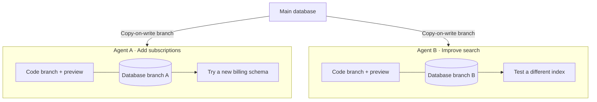

I tried [Neon](https://neon.com/) for a hobby project, and switching to it was very easy. I love the idea of autoscaling and scaling to zero for a lot of the projects I spin up these days. Some get used occasionally. Some sit untouched for a while.

For this particular project, though, the bill fluctuated more than I wanted. Neon's database cost went up to around $30–40 a month, then down to $5–10. The same app had been stable on a $5 DigitalOcean server, and I didn't notice much difference in performance.

I didn't use Neon long enough to make a broad judgment about it. This was one small workload, and I haven't broken down the usage enough to say exactly what caused those swings. But for that app, the extra variability didn't feel worthwhile.

I moved back to a VPS managed with [Coolify](/my-coolify-experience-after-a-year/). A predictable bill worked better for what I needed.

## Branching is what makes me look again

Database branching is brilliant. And the more I work with parallel agents, the more useful it looks.

Each agent can have its own Git branch and preview deployment. But if they're all pointing at the same development database, a schema change in one experiment can break another. The code is isolated, but the state they're working against is shared.

Each experiment can change its own database without affecting the others or the original.

Neon's [database branches](https://neon.com/docs/introduction/branching) are isolated, copy-on-write clones. An agent could try a migration on its own branch without changing the database another agent is using. That makes it easier to review the whole experiment, including what it does to the data.

The [Vercel integration](https://neon.com/docs/guides/vercel-managed-integration) can create a database branch for each preview deployment and supply its connection variables. So the preview can have database state that matches the code I'm reviewing.

There's also an [official Neon MCP server](https://neon.com/docs/ai/neon-mcp-server) for agents to manage branches and work with development databases. I'd want temporary branches cleaned up when the experiment is done, rather than collecting another pile of environments to maintain.

I haven't put that workflow into practice yet. But it's a much more interesting reason for me to try Neon again. For a steady hobby app, I'm happy with my VPS. When I'm running several experiments at once, having a database branch for each one starts to earn its place.
