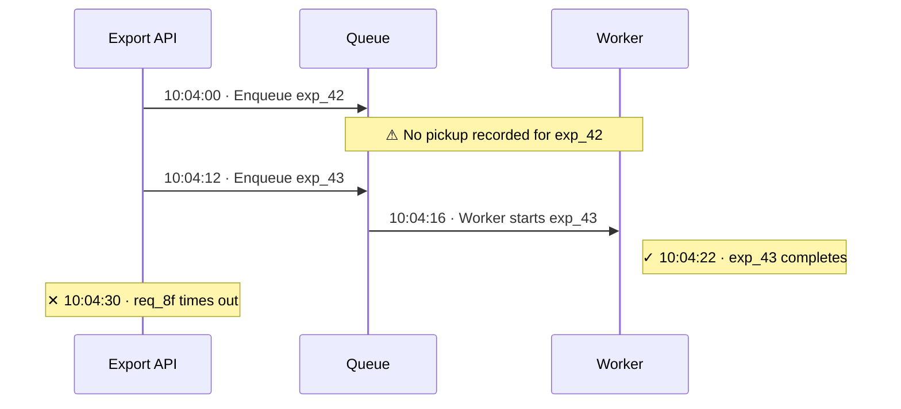
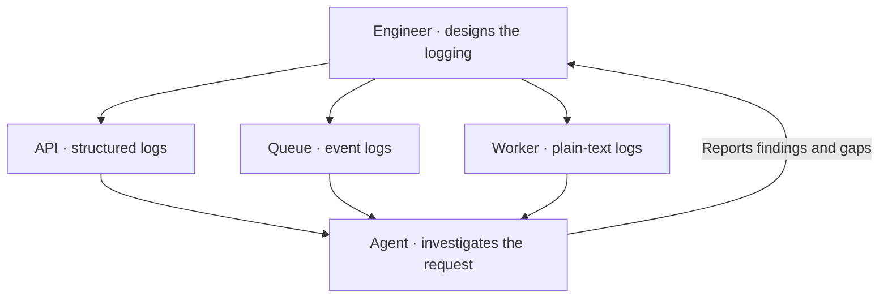

import Image from "@components/Image.astro";

I think knowing how to work with logs is one of the most useful skills an engineer can have. When something breaks in production, the logs are how I go back and see what the system actually did. What I can piece together depends on what we thought to record in the first place.

When I [wrote about using Coolify for a year](/my-coolify-experience-after-a-year/), I mentioned how quickly I wanted log aggregation. I could already open a container and see its output. What I wanted was to follow one request across containers and see what each service knew at the time.

## What would I wish I'd logged?

Microservices make this harder. Each service logs its own part of the work, and a single request can leave clues in several places. I want an ID I can search for across those boundaries. A request ID can follow the call from service to service. If the work continues in a background job, I want the API to log the request ID and the job ID together so I can pick up the trail in the worker logs.

Say someone reports that their export timed out around 10:04. I pull a slice of logs from around that time. Other exports are running, the worker is doing maintenance, and the API is serving other requests.

```text
10:03:58.712 [worker:w2] starting export exp_41 (attempt 1)
10:03:59.980 proxy: "GET /healthz HTTP/1.1" 200 2ms
10:04:00.004 api INFO export requested request_id=req_8f job_id=exp_42
{"ts":"10:04:00.021","svc":"queue","event":"enqueued","job":"exp_42","depth":4}
10:04:01.377 cache INFO hit key=exports:list ttl=19s
10:04:02.191 proxy: "GET /exports?page=2 HTTP/1.1" 200 34ms req=req_90
10:04:06.033 [worker:w2] done exp_41, wrote 1802 rows
10:04:08.546 [worker:w2] WARN lease renewal took 610ms
    lease=worker:w2 next_renewal=10:04:13
10:04:09.108 api WARN client disconnected request_id=req_8e path=/reports
10:04:12.211 api INFO export requested request_id=req_91 job_id=exp_43
{"ts":"10:04:12.226","svc":"queue","event":"enqueued","job":"exp_43","depth":3}
10:04:16.904 [worker:w1] starting export exp_43 (attempt 1)
10:04:19.063 proxy: "GET /healthz HTTP/1.1" 200 1ms
10:04:22.481 [worker:w1] done exp_43, wrote 96 rows
10:04:30.005 api WARN context deadline exceeded request_id=req_8f
    POST /exports duration_ms=30001
```

Logs are messy. One service gives me JSON, another spits out a line of text, and a third puts half the message on the next line. The format and the field names can vary a ton, even within one system. Keeping all of that straight in my head while following a request takes real concentration. For an agent, pulling the IDs out of those different formats and lining the events up is the easy part.

<div className="export-sequence">



</div>

<style>{`
  .export-sequence .pele-note:nth-of-type(1) {
    --note-bg: #fef3c7;
    --note-ink: #92400e;
  }
  .export-sequence .pele-note:nth-of-type(2) {
    --note-bg: #dcfce7;
    --note-ink: #166534;
  }
  .export-sequence .pele-note:nth-of-type(3) {
    --note-bg: #fee2e2;
    --note-ink: #991b1b;
  }
  .export-sequence .pele-note rect {
    fill: var(--note-bg);
    stroke: var(--note-ink);
  }
  .export-sequence .pele-note text {
    fill: var(--note-ink);
  }
`}</style>

I'd record how the job finished and how long the big steps took: fetching the data, building the file, and uploading it. A failure event should tell me which step failed and why, if the worker knows. Those few timings are also a good starting point for profiling a slow export. If most of the time went into building the file, I know where to look more closely. I'd only turn on finer-grained logging, like timing individual batches of rows, once I had a question those checkpoints couldn't answer.

How much I keep depends on the questions I expect to ask. A sample of routine successes might be enough to see whether exports are generally slowing down. Reconstructing a single failure takes the events for that job, including some of the ordinary steps that led up to it. And if people tend to report problems a few days later, I need somewhere to look by the time they do.

## The agent is the detective

I want agent-assisted analysis to be the default way I work with logs. My first move should be to ask for a timeline of the failed export next to one that worked, with the job IDs and the original lines. Then I can follow up on whatever looks off without building a new query every time I have a question.

This is the part that feels like being the detective in *Minority Report*. The agent is my big screen. Pull up the worker logs. Put the last deploy next to them. Now show me the jobs that ran right before this one.

<Image
  src="/images/blog/2026/minority-report-log-analysis.webp"
  alt="Tom Cruise as John Anderton, using two glowing gloves to manipulate a transparent screen in Minority Report."
  width={960}
  height={720}
  center
  caption="Me asking for the worker logs one more time."
/>

## What’s left for the human?

I care less about which log engine I use now. If it stores what I need and lets me query it, I can work with it. The API might write structured logs to one service while a worker writes plain text somewhere else. An agent with read access to both can use each system's tools and query syntax, then bring the results together. I can spend less time getting fluent in each tool.

What I do care about is whether the dots connect. Say the agent finds no “job started” event. I need to know whether the worker logs that event in production, whether it could have been sampled out, and whether the logs from that day are still around. Maybe the event is there, but the worker never recorded the job ID I need to find it.

I think of the agent as the detective and the engineer as the architect. The agent follows the trail across the tools it can read. The engineer decides what evidence each service leaves behind.



That's where knowing the system pays off. I need to know why we log something, how much detail is worth keeping, and what an agent needs access to. If I can't follow a request from the API to the worker, that's where I'd look to add a log line.

When I'm investigating an incident and the agent isn't getting anywhere, I like to ask, “What logs, metrics, or traces would have helped us find this faster?” I'll hear out its suggestions and decide what to add myself. An agent can come up with a dozen things to log in seconds, and if I ship all of them, I can end up storing a ridiculous amount of data. Sometimes one well-placed log line is all I need for the next incident.
